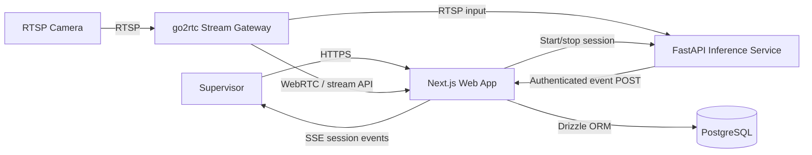
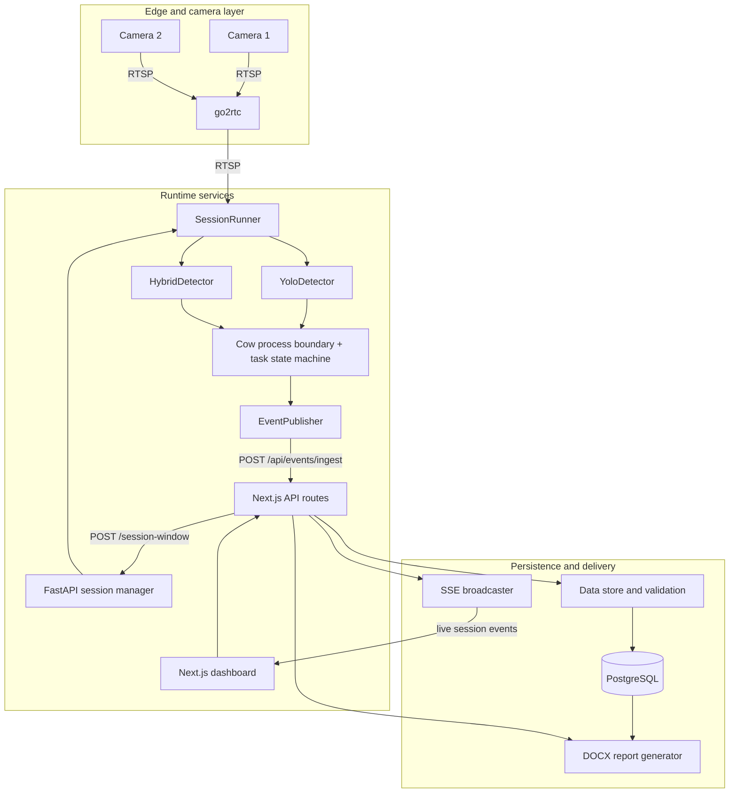
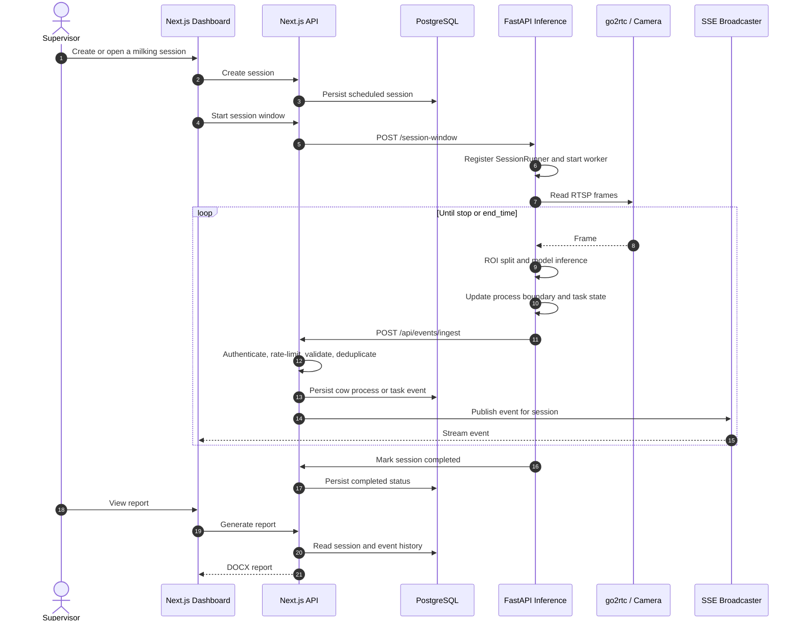
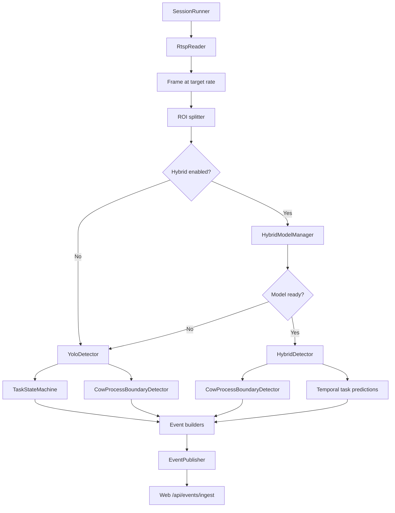

# Milking Monitor Architecture

This document describes the deployed architecture of the Milking Monitor platform,
the runtime inference pipeline, and the optional hybrid model used for temporal
milking-task recognition.

## 1. System Context

The platform monitors milking sessions from one or more RTSP cameras. A supervisor
creates a session in the web application. The web application starts an inference
window, the inference service processes camera frames, and task events are sent
back to the web application for persistence and live display.

### Main deployable components

| Component | Responsibility | Default port |
|---|---|---:|
| Next.js web app | Authentication, session management, dashboard, reports, API routes | `3000` |
| FastAPI inference service | Session workers, frame processing, detection, task events | `8001` |
| go2rtc | RTSP restreaming and browser-friendly WebRTC access | `1984`, `8554`, `8555` |
| PostgreSQL | Sessions, cow processes, task events, reports, audit data | `5432` |
| Hybrid model package | Feature extraction, LSTM definition, training and checkpoints | Python package |

The development topology is defined in
[`docker-compose.yml`](../docker-compose.yml). The web application is the system
of record for persisted events; the inference service does not write directly to
PostgreSQL.

## 2. UML Component / System Design

### Responsibilities and boundaries

1. **Web application** owns users, sessions, permissions, validation, event
   persistence, reports, and the live dashboard.
2. **Inference service** owns camera consumption, model execution, in-memory
   session state, and event publishing. It communicates with the web application
   over HTTP.
3. **go2rtc** isolates camera protocol handling from browser and inference
   consumers. It can expose live streams and local fallback video.
4. **PostgreSQL** stores durable business data. The in-memory SSE broadcaster
   provides low-latency updates for connected dashboard clients.

## 3. UML Runtime Sequence

### Event contract

The inference service publishes two event categories:

- `cow_process`: a cow-position process has started or completed.
- `task_event`: one of the six milking tasks has a status, confidence score,
  completion percentage, timestamps, and cow position.

The ingest route protects the boundary with an inference token, request validation,
rate limiting, and task-event deduplication before publishing the event to
connected clients.

## 4. Inference Service Architecture

The `SessionRunner` selects one of two modes using `USE_HYBRID_MODEL`:

The runner targets approximately **5 FPS**, checks the session deadline, responds
to stop signals, and closes the stream and HTTP publisher during shutdown.

## 5. Hybrid Model Architecture

The hybrid model is an optional temporal classifier. It combines two independent
YOLO feature branches for each frame, then uses a bidirectional LSTM to classify
the recent sequence.

```mermaid
flowchart LR
    Frame[Input frame] --> Pose[YOLOv8-Pose]
    Frame --> Objects[YOLOv8 object detector]

    Pose --> PoseFeatures[PoseFeatureExtractor<br/>512 features]
    Objects --> ObjectFeatures[ObjectFeatureExtractor<br/>128 features]

    PoseFeatures --> Concatenate[Concatenate<br/>640 features per frame]
    ObjectFeatures --> Concatenate
    Concatenate --> Buffer[Sequence buffer<br/>30 frames]
    Buffer --> Projection[Linear 640 to 64<br/>ReLU + Dropout]
    Projection --> LSTM[2-layer bidirectional LSTM<br/>hidden size 256]
    LSTM --> Attention[Attention pooling<br/>512 to 32 to 1]
    Attention --> Classifier[Linear 512 to 32<br/>ReLU + Dropout]
    Classifier --> Output[Linear 32 to 6]
    Output --> Smooth[Confidence threshold<br/>3 of 5 temporal agreement]
    Smooth --> Tasks[TASK-01 ... TASK-06]
```

### Feature representation

| Branch | Size | Example signals |
|---|---:|---|
| Pose features | 512 | Person location, 17 keypoints, arm posture, motion, row position, action and visual statistics |
| Object features | 128 | Class counts, confidence, bounding boxes, spatial grid, temporal statistics and object-person proximity |
| Combined frame vector | 640 | Concatenated pose and object features |
| Temporal input | `30 x 640` | A rolling sequence of approximately six seconds at 5 FPS |

The implementation is in the
[`hybrid-model`](../../../hybrid-model/) package. Runtime integration is handled
by [`hybrid_detector.py`](../apps/inference-service/src/detection/hybrid_detector.py)
and [`multimodal_feature_extractor.py`](../apps/inference-service/src/detection/multimodal_feature_extractor.py).

### Temporal decision policy

The hybrid detector:

1. Extracts new YOLO features periodically and reuses the latest feature between
   extraction frames (`yolo_skip`).
2. Waits until 30 feature vectors are available.
3. Converts LSTM logits to class probabilities.
4. Rejects predictions below the configured confidence threshold.
5. Requires at least 3 matching predictions in the latest 5 predictions.
6. Prevents rapid task switching and requires a minimum task duration.
7. Emits the confirmed task to the session runner.

This smoothing is important because a single frame should not change the recorded
milking task.

## 6. Training-to-Production Flow

```mermaid
flowchart LR
    Video[Recorded milking video] --> Frames[Frame extraction]
    Frames --> Labels[Task labels / annotations]
    Labels --> Dataset[Sequence dataset]
    Dataset --> Train[YOLO feature extraction + LSTM training]
    Train --> Checkpoint[best_model.pt]
    Checkpoint --> Deploy[Inference-service model path]
    Deploy --> Load[HybridModelManager]
    Load --> Infer[HybridDetector]
    Infer --> Events[Task events]
```

Training configuration and data preparation live in
[`hybrid-model/configs`](../../../hybrid-model/configs/) and
[`hybrid-model/src/training`](../../../hybrid-model/src/training/). The trained
checkpoint is loaded at runtime when hybrid inference is enabled. If the
checkpoint is unavailable or cannot be loaded, the service reports the condition
and the session runner can use the basic YOLO path.

## 7. Data and Reliability Design

- **Authentication:** inference-to-web requests use a shared service token.
- **Validation:** event payloads are checked against the web application's
  contract before persistence.
- **Deduplication:** task-event fingerprints prevent repeated task records.
- **Rate limiting:** the ingest route limits event traffic per client.
- **Health checks:** `/`, `/health`, `/ready`, and `/hybrid-status` expose
  service and model readiness.
- **Session safety:** the inference service tracks active runners, supports
  explicit stop requests, and has a deadline watchdog for overdue sessions.
- **Fallbacks:** go2rtc can provide a local fallback video, and the inference
  runner can fall back from hybrid inference to the basic YOLO pipeline when the
  hybrid model is not ready.

## 8. Source Map

| Area | Source |
|---|---|
| FastAPI entrypoint and lifecycle | [`apps/inference-service/src/main.py`](../apps/inference-service/src/main.py) |
| Session processing | [`apps/inference-service/src/runtime/session_runner.py`](../apps/inference-service/src/runtime/session_runner.py) |
| Frame ingestion and ROIs | [`apps/inference-service/src/ingestion`](../apps/inference-service/src/ingestion/) |
| Detection implementations | [`apps/inference-service/src/detection`](../apps/inference-service/src/detection/) |
| Event building and publishing | [`apps/inference-service/src/events`](../apps/inference-service/src/events/) |
| Web ingest boundary | [`apps/web/app/api/events/ingest/route.ts`](../apps/web/app/api/events/ingest/route.ts) |
| Database schema | [`apps/web/lib/db/schema`](../apps/web/lib/db/schema/) |
| Live event delivery | [`apps/web/lib/realtime/broadcast.ts`](../apps/web/lib/realtime/broadcast.ts) |
| Model architecture and training | [`hybrid-model/doc/ARCHITECTURE.md`](../../../hybrid-model/doc/ARCHITECTURE.md) |
